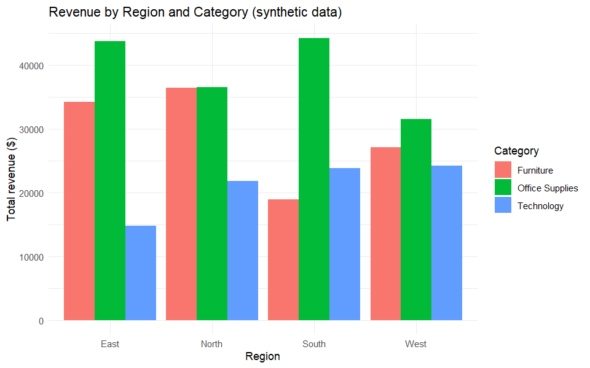

# Markdown Buddy – Synthetic Sales Summary in R

> **AI Assistance Declaration:** I used Claude (Anthropic, Opus 5.5) for README structure, Markdown formatting and wording suggestions. Prompts used: see the [AI Assistance Disclosure](#ai-assistance-disclosure) section and `Appendix_AI_Prompts.md`. I verified outputs using GitHub's Markdown preview, by running the R script and knitting the `.Rmd` in R 4.6.1, and by cross-checking totals in base R. All final calculations are done by myself. I am responsible for the accuracy and originality of this work.


A small, reproducible R project that **generates a synthetic retail sales dataset**, summarises revenue by region and product category, and documents the workflow with R Markdown.

Created by **Nadeeka** (Student ID: 664430944) for **BDA400 – Data Science Tools and Techniques, Assignment 1**.

---

## Table of Contents

- [Overview](#overview)
- [Project Structure](#project-structure)
- [Requirements](#requirements)
- [Installation](#installation)
- [Example Code](#example-code)
- [Outputs](#outputs)
- [Data](#data)
- [License](#license)
- [AI Assistance Disclosure](#ai-assistance-disclosure)

## Overview

The project demonstrates a simple *generate → summarise → visualise* workflow:

1. Create 500 synthetic orders with region, category, units and unit price.
2. Calculate revenue per order (`units × unit_price`).
3. Summarise orders, units, total revenue and average order value by region.
4. Plot revenue by region and category.

## Project Structure

```text
markdown-buddy-nadeeka/
├── README.md                 # Project documentation (this file)
├── sales_summary.Rmd         # R Markdown documentation of the script
├── Reflection.md             # Answers to the reflection questions
├── Appendix_AI_Prompts.md    # All AI prompts and key responses
├── LICENSE                   # MIT license
├── scripts/
│   └── sales_summary.R       # Main analysis script
├── data/
│   └── synthetic_sales.csv   # Generated synthetic dataset
└── output/
    ├── region_summary.csv    # Summary table
    └── revenue_by_region.png # Chart
```

## Requirements

| Software / Package | Version tested | Purpose                 |
|--------------------|----------------|-------------------------|
| R                  | 4.6.1          | Language runtime        |
| `dplyr`            | 1.2.1          | Data manipulation       |
| `ggplot2`          | 4.0.3          | Visualisation           |
| `rmarkdown`, `knitr` | latest       | Knitting the `.Rmd`     |

## Installation

1. Clone the repository:

   ```bash
   git clone https://github.com/huraira2/markdown-buddy-nadeeka.git
   cd markdown-buddy-nadeeka
   ```

2. Install the required packages in R:

   ```r
   install.packages(c("dplyr", "ggplot2", "rmarkdown", "knitr"))
   ```

## Example Code

Run the full script from the project root:

```r
source("scripts/sales_summary.R")
```

Knit the documentation to HTML:

```r
rmarkdown::render("sales_summary.Rmd")
```

Core summary step used in the script:

```r
region_summary <- sales %>%
  group_by(region) %>%
  summarise(
    orders        = n(),
    total_revenue = sum(revenue),
    avg_order     = round(mean(revenue), 2)
  ) %>%
  arrange(desc(total_revenue))
```

## Outputs

Running the script with `set.seed(400)` produces:

| Region | Orders | Total units | Total revenue ($) | Avg. order ($) |
|--------|-------:|------------:|------------------:|---------------:|
| North  | 129    | 742         | 94,813            | 735            |
| East   | 127    | 703         | 92,696            | 730            |
| South  | 127    | 687         | 87,002            | 685            |
| West   | 117    | 632         | 82,951            | 709            |



## Data

All data is **synthetic** and generated inside `scripts/sales_summary.R`. No real, personal or confidential data is used.

## License

This project is released under the [MIT License](LICENSE).

## AI Assistance Disclosure

- **Tool used:** Claude (Anthropic, model Opus 5.5), accessed through the Claude desktop app, November 2026.
- **Main prompts given:**
  1. *"Explain what sections a good GitHub README for an R data analysis project should include."*
  2. *"Here's a summary of my R project: [summary]. Generate a professional README.md file using Markdown."*
  3. *"Add sections for Installation, Example Code, and License. Keep tone concise and professional."*
  4. *"Review the Markdown for syntax errors and suggest 2 improvements for clarity."*
  5. *"Here's my R script description. Suggest Markdown formatting and code block examples."*
  6. *"Is the Markdown consistent with RMarkdown best practices?"*
- **Changes made after reviewing the outputs:**
  - Replaced placeholder results with the actual numbers I produced by running the script.
  - Added a **Table of Contents** and a **Project Structure** tree (AI clarity suggestion #1).
  - Converted the requirements list into a table with tested versions (AI clarity suggestion #2).
  - Added language tags (`r`, `bash`, `text`) to every code block so GitHub highlights them.
  - Added a **Verification** section to the `.Rmd` that recalculates totals in base R.
  - Compared the structure with the [dplyr README](https://github.com/tidyverse/dplyr) and kept the Overview → Installation → Usage order it uses.

Full prompts and key responses are in [`Appendix_AI_Prompts.md`](Appendix_AI_Prompts.md).
